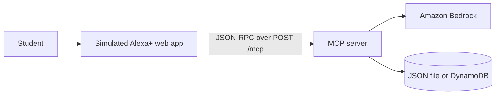

# Study Buddy - MCP server + simulated Alexa+ experience

A study assistant exposed as a **Model Context Protocol (MCP) server** (spec 2025-11-25, **Streamable HTTP**) so an Alexa+-style agent can explain topics, manage study tasks and exam dates, and run spoken quizzes.

- **Track:** Alexa+ (self-hosted MCP server, plus a simulated Alexa+ web app for the demo)
- **Mini challenges:** AWS Builder (Amazon Bedrock Converse API, optional DynamoDB) and Open Source (MIT)

## MCP tools
| Tool | Purpose |
|---|---|
| `explain_topic(topic)` | 2-3 spoken sentences, via Amazon Bedrock |
| `add_task(task)` / `list_tasks()` / `complete_task(task)` | Study task list |
| `set_exam(subject, date YYYY-MM-DD)` / `next_exam()` | Exam countdown |
| `start_quiz(subject)` / `answer_quiz(answer)` | 3-question quiz with score and lifetime stats |

Server: `mcp_server.py` implements `initialize`, `ping`, `tools/list`, `tools/call`; notifications get `202`; `GET /mcp` returns `405` (no server-initiated stream); `Origin` header is validated; `Mcp-Session-Id` is issued on initialize; users are separated by the optional `X-User-Id` header. Zero dependencies (Python 3.10+ standard library).

## Run
```bash
python mcp_server.py            # http://127.0.0.1:8765/mcp  and web app at http://127.0.0.1:8765/
python test_mcp.py              # 9 integration tests
```
Open `http://127.0.0.1:8765/` for the **simulated Alexa+ experience**: type or use the Mic button (browser speech recognition) and enable "speak replies". A rule-based router turns what you say into MCP `tools/call` requests; every call is logged on screen.

Try: "explain photosynthesis", "add task read chapter two", "list my tasks", "my physics exam is on November 5th", "when is my next exam", "quiz me on biology".

## AI (Amazon Bedrock) and storage
```bash
pip install boto3
export BEDROCK_MODEL_ID=<model or inference profile ID enabled in your account>
export TABLE_NAME=<DynamoDB table with string partition key userId>   # optional; default is data.json
```
Without these, the server runs fully offline with a fallback tip instead of an AI answer.

## Connect another MCP client
Point any Streamable-HTTP MCP client at `http://127.0.0.1:8765/mcp` (to expose it beyond localhost, put it behind HTTPS and set `HOST` and `ALLOWED_ORIGINS`).

## Architecture


## Limitations
The Alexa+ app is a simulation (rule-based router), not the real Alexa+ service; quiz questions come from a built-in bank.

License: MIT
